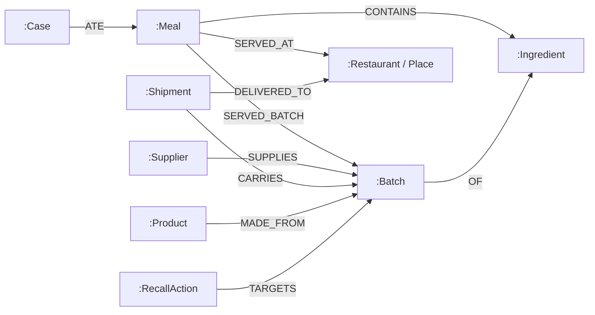

# ForkTrace: Connected Outbreak Source Investigation

Live Deployment: [https://forktrace-forktrace.vercel.app](https://forktrace-forktrace.vercel.app)  
*(Note: As a serverless deployment connecting to cloud graph infrastructure, the initial page load may take up to a minute if the instance is cold.)*

---

## 1. What ForkTrace Is

ForkTrace is a graph-powered investigative engine that pinpoints suspected contamination sources in foodborne illness outbreaks. By traversing multi-hop supply chain connections in FalkorDB, it bridges direct kitchen lot records with inferred delivery paths and ingredient shelf-life windows. Rather than producing opaque accusations, ForkTrace computes epidemiological attack rates, partitions competing hypotheses, flags data conflicts, and surfaces auditable evidence paths for human food-safety review.

---

## 2. Hackathon & Project Context

- **Hackathon:** Graph Hacks 2026
- **Track:** Agents That Act on Connected Data
- **Project Start Date:** October 15, 2026
- **Target Database:** FalkorDB (Cloud and Local Docker)

---

## 3. What ForkTrace Really Does

ForkTrace runs a complete investigative workflow directly against graph data stored in FalkorDB:

1. **Dual Evidence Ingestion:** It queries both direct kitchen lot records (`:SERVED_BATCH`) and inferred delivery records (`:Shipment` deliveries matching ingredient shelf-life windows during which a meal was prepared).
2. **Weighted Epidemiological Scoring:** Computes attack rate ($\text{cases} / \text{exposed}$), outbreak coverage ($\text{cases} / \text{total\_cases}$), composite score ($\text{attack\_rate} \times \text{coverage}$), and lead ratio ($\text{top\_score} / \text{second\_score}$).
3. **Competing Hypotheses Partitioning:** Automatically categorizes all 42 outbreak cases into mutually exclusive groups:
   - Cases explained *only* by the top candidate batch
   - Cases explained *only* by the runner-up batch
   - Cases explained by *both* candidates
   - Cases unexplained by either
4. **Data Integrity & Conflict Detection:** Scans the supply network for missing shipment records—kitchen logs that claim to have served a batch at a restaurant where no shipment record exists.
5. **Review Scope & Recall Proposal:** Aggregates all affected destinations (shipping destinations plus conflicted restaurants) with causal reasons, and prepares a structured recall proposal.
6. **Audited Recall Action:** Persists parameterized `RecallAction` nodes directly into the graph upon human approval, maintaining complete synthetic-data disclaimers and auditor metadata.

---

## 4. Why the Graph Matters

In real food supply chains, outbreak investigations stall because documentation is fragmented:
- Some kitchens log exact supplier lot codes (`Meal -[:SERVED_BATCH]-> Batch`).
- Other kitchens only record the dish and ingredient (`Meal -[:CONTAINS]-> Ingredient`), while shipping manifests record delivery dates (`Shipment -[:CARRIES]-> Batch`, `Shipment -[:DELIVERED_TO]-> Restaurant`).

A relational database or tabular spreadsheet struggles to perform multi-hop traversals across fluctuating dates, shelf-life offsets, and intermediate distribution nodes. In FalkorDB, ForkTrace traverses:

$$\text{Case} \xrightarrow{\text{ATE}} \text{Meal} \xrightarrow{\text{SERVED\_AT}} \text{Restaurant} \xleftarrow{\text{DELIVERED\_TO}} \text{Shipment} \xrightarrow{\text{CARRIES}} \text{Batch} \xrightarrow{\text{OF}} \text{Ingredient}$$

This allows the engine to infer batch exposure during valid shelf-life windows ($\text{shipment\_day} \le \text{meal\_day} \le \text{shipment\_day} + \text{shelf}$), detect missing shipping logs, and maintain a verifiable chain of custody in microseconds. Without FalkorDB's connected Cypher traversals, this multi-hop inference cannot run.

---

## 5. Graph Data Model

The outbreak knowledge graph consists of 6 primary node labels and 8 relationship types:



### Node Labels
- `:Supplier`: Raw ingredient producers (`id`, `name`)
- `:Ingredient`: Ingredient types (`id`, `name`, e.g., Spinach, Tomatoes, Chicken, Lettuce)
- `:Batch`: Harvested lots (`id`, `shelf` in days)
- `:Shipment`: Distribution transit events (`id`, `day`)
- `:Place` / `:Restaurant`: Delivery endpoints and dining locations (`id`, `name`)
- `:Meal`: Consumed meal events (`id`, `day`)
- `:Case`: Reported foodborne illness cases (`id`)
- `:Product`: Packaged goods made from batches (`id`, `name`)
- `:RecallAction`: Human-approved simulated recall records (`id`, `timestamp`, `approved_by`, `status`, `synthetic_disclaimer`)

---

## 6. Cypher Queries

The investigation relies on 10 parameterized Cypher queries located in `backend/app/queries/`:

### 1. `total_cases.cypher`
Returns the total number of confirmed illness cases in the outbreak.
```cypher
MATCH (c:Case)
RETURN count(c) AS total_cases
```

### 2. `batch_info.cypher`
Retrieves supplier, ingredient, and shelf-life metadata for a specific batch.
```cypher
MATCH (sup:Supplier)-[sp:SUPPLIES]->(b:Batch {id: $batch_id})-[of:OF]->(i:Ingredient)
RETURN b.id AS batch_id, b.shelf AS shelf_life, i.name AS ingredient, sup.name AS supplier
```

### 3. `rank_recorded.cypher`
Aggregates cases and meals directly linked to batches via kitchen lot records.
```cypher
MATCH (b:Batch)
OPTIONAL MATCH (m:Meal)-[sb:SERVED_BATCH]->(b)
OPTIONAL MATCH (c:Case)-[a:ATE]->(m)
WITH b, count(DISTINCT m) AS exposed_meals, count(DISTINCT c) AS cases
RETURN b.id AS batch_id, exposed_meals, cases
ORDER BY cases DESC, exposed_meals DESC, batch_id ASC
```

### 4. `rank_inferred.cypher`
Infers exposure via restaurant shipment delivery within ingredient shelf-life windows when explicit kitchen lot tags are absent.
```cypher
MATCH (b:Batch)-[of:OF]->(i:Ingredient)
OPTIONAL MATCH (m:Meal)-[ct:CONTAINS]->(i),
               (m)-[sa:SERVED_AT]->(r:Restaurant),
               (s:Shipment)-[cr:CARRIES]->(b),
               (s)-[del:DELIVERED_TO]->(r)
WHERE s.day <= m.day AND m.day <= s.day + b.shelf
OPTIONAL MATCH (m)-[sb_check:SERVED_BATCH]->(:Batch)-[of_check:OF]->(i)
WITH b, m, count(sb_check) AS has_served
WHERE m IS NULL OR has_served = 0
OPTIONAL MATCH (c:Case)-[a:ATE]->(m)
WITH b, count(DISTINCT m) AS exposed_meals, count(DISTINCT c) AS cases
RETURN b.id AS batch_id, exposed_meals, cases
ORDER BY cases DESC, exposed_meals DESC, batch_id ASC
```

### 5. `cases_recorded.cypher`
Returns the distinct case IDs directly tagged to a specific batch.
```cypher
MATCH (c:Case)-[a:ATE]->(m:Meal)-[sb:SERVED_BATCH]->(b:Batch {id: $batch_id})
RETURN DISTINCT b.id AS batch_id, c.id AS case_id
ORDER BY case_id ASC
```

### 6. `cases_inferred.cypher`
Returns the distinct case IDs linked to a batch through delivery time-window inference.
```cypher
MATCH (b:Batch {id: $batch_id})-[of:OF]->(i:Ingredient),
      (c:Case)-[a:ATE]->(m:Meal)-[ct:CONTAINS]->(i),
      (m)-[sa:SERVED_AT]->(r:Restaurant),
      (s:Shipment)-[cr:CARRIES]->(b),
      (s)-[del:DELIVERED_TO]->(r)
WHERE s.day <= m.day AND m.day <= s.day + b.shelf
OPTIONAL MATCH (m)-[sb_check:SERVED_BATCH]->(:Batch)-[of_check:OF]->(i)
WITH b, c, m, count(sb_check) AS has_served
WHERE has_served = 0
RETURN DISTINCT b.id AS batch_id, c.id AS case_id
ORDER BY case_id ASC
```

### 7. `conflicts.cypher`
Flags data integrity violations where kitchen records log a batch served at a restaurant that never received a valid shipment during the shelf-life window.
```cypher
MATCH (m:Meal)-[sb:SERVED_BATCH]->(b:Batch),
      (m)-[sa:SERVED_AT]->(r:Restaurant)
OPTIONAL MATCH (s:Shipment)-[cr:CARRIES]->(b),
               (s)-[del:DELIVERED_TO]->(r)
WHERE s.day <= m.day AND m.day <= s.day + b.shelf
WITH m, b, r, count(s) AS valid_shipments
WHERE valid_shipments = 0
RETURN m.id AS meal_id, m.day AS meal_day, r.id AS restaurant_id, b.id AS batch_id
ORDER BY meal_id ASC, batch_id ASC
```

### 8. `evidence_path.cypher`
Extracts traceable case-to-batch chains indicating whether evidence is recorded or inferred.
```cypher
MATCH (c:Case)-[a:ATE]->(m:Meal)
OPTIONAL MATCH (m)-[sb:SERVED_BATCH]->(b_rec:Batch {id: $batch_id})
OPTIONAL MATCH (m)-[sa:SERVED_AT]->(r:Restaurant)<-[del:DELIVERED_TO]-(s:Shipment)-[cr:CARRIES]->(b_inf:Batch {id: $batch_id})-[of:OF]->(i:Ingredient)<-[ct:CONTAINS]-(m)
WHERE s.day <= m.day AND m.day <= s.day + b_inf.shelf
OPTIONAL MATCH (m)-[sb_check:SERVED_BATCH]->(:Batch)-[of_check:OF]->(i)
WITH c, m, b_rec, b_inf, r, s, count(sb_check) AS has_served
WHERE b_rec IS NOT NULL OR (b_inf IS NOT NULL AND has_served = 0)
RETURN c.id AS case_id,
       m.id AS meal_id,
       CASE WHEN b_rec IS NOT NULL THEN 'RECORDED' ELSE 'INFERRED' END AS evidence_type,
       $batch_id AS batch_id,
       r.id AS restaurant_id,
       s.id AS shipment_id
ORDER BY case_id ASC, meal_id ASC
LIMIT $limit
```

### 9. `affected.cypher`
Finds all physical destinations and shipment events that received a specific batch.
```cypher
MATCH (s:Shipment)-[cr:CARRIES]->(b:Batch {id: $batch_id}),
      (s)-[del:DELIVERED_TO]->(p:Place)
RETURN DISTINCT p.id AS place_id, labels(p) AS place_labels, s.id AS shipment_id, s.day AS shipment_day
ORDER BY s.day ASC, place_id ASC
```

### 10. `products.cypher`
Maps downstream consumer food products manufactured from a specific batch.
```cypher
MATCH (p:Product)-[mf:MADE_FROM]->(b:Batch {id: $batch_id})
RETURN p.id AS product_id, p.name AS product_name, b.id AS batch_id
ORDER BY product_id ASC
```

---

## 7. Scoring & Confidence Rules

All scoring formulas are pure mathematical functions implemented in `backend/app/scoring.py` with zero hard-coded scenario expectations:

- **Weighting:** Direct recorded evidence receives full weight ($1.0$), while inferred delivery paths receive half weight ($0.5$):
  $$\text{weighted\_cases} = \text{recorded\_cases} + 0.5 \times \text{inferred\_cases}$$
  $$\text{weighted\_exposed} = \text{recorded\_meals} + 0.5 \times \text{inferred\_meals}$$
- **Attack Rate:** Proportion of exposed consumers who fell ill:
  $$\text{attack\_rate} = \frac{\text{weighted\_cases}}{\text{weighted\_exposed}}$$
- **Coverage:** Proportion of total outbreak cases explained by the batch:
  $$\text{coverage} = \frac{\text{weighted\_cases}}{\text{total\_cases}}$$
- **Composite Score:** Product of attack rate and coverage:
  $$\text{score} = \text{attack\_rate} \times \text{coverage}$$
- **Lead Ratio:** Separation between the top candidate and the runner-up:
  $$\text{lead\_ratio} = \frac{\text{top\_score}}{\text{second\_score}}$$

### Confidence Classification
- `insufficient`: Top linked cases $< 5$ (`MIN_CASES`).
- `high`: `lead_ratio >= 2.0` AND `attack_rate >= 0.7` AND `conflicts == 0`.
- `low`: `lead_ratio < 1.2`.
- `medium`: Otherwise.

### Why Baseline Confidence is `medium`
In our baseline seeded scenario:
- Top candidate (`SP-2041`): Score $= 0.5670$, Attack Rate $= 74.4\%$, Cases $= 28$ recorded $+ 8$ inferred $= 32.0$ weighted.
- Runner-up (`TM-77`): Score $= 0.3565$, Attack Rate $= 43.4\%$, Cases $= 30$ recorded $+ 9$ inferred $= 34.5$ weighted.
- Lead Ratio: $0.5670 / 0.3565 = \mathbf{1.591}$.

Because `lead_ratio` ($1.591$) is below the strict $2.0$ threshold required for `high` confidence, but comfortably above the $1.2$ threshold for `low`, ForkTrace honestly classifies the investigation as **`medium`** confidence.

---

## 8. How the Demo Works

ForkTrace features an interactive simulation scenario to demonstrate graph anomaly detection:

1. **Baseline State:** Batch `SP-2041` (Spinach) leads with score $0.5670$, $0$ conflicts, and $8$ inferred cases.
2. **Missing-Shipment Anomaly:** Click **"Simulate Remove SP-2041 → R3 Shipment"** (under *Demo Controls*).
   - This executes `remove_shipment("SP-2041", "R3")` in FalkorDB, simulating real-world data loss where delivery manifests are lost or unrecorded.
   - When the graph re-evaluates:
     - Recorded evidence remains unchanged ($28$ recorded cases).
     - Inferred cases for `SP-2041` drop from $8$ to $4$ because delivery paths through `R3` are severed.
     - The engine immediately flags **16 conflict records** because kitchen logs at restaurant `R3` report serving `SP-2041` without a delivery shipment.
     - Restaurant `R3` remains in the **Review Scope** with the causal reason: *"kitchen records show this batch, but the shipment record is missing"*.
3. **Reset Baseline:** Click **"Reset Graph Scenario"** to restore FalkorDB to the pristine seeded scenario ($0$ conflicts, baseline restored).
4. **Recall Approval:** Click **"Approve Simulated Recall"** to execute a parameterized write in FalkorDB creating a `:RecallAction` node linked via `-[:TARGETS]->` to the leading batch.

---

## 9. Setup & Running Locally

### Option A: FalkorDB Cloud (Used in live deployment)
Set your Cloud instance connection variables in `backend/.env`:
```dotenv
FALKORDB_HOST=your-instance.falkordb.cloud
FALKORDB_PORT=53335
FALKORDB_USERNAME=falkordb
FALKORDB_PASSWORD=your_password
FALKORDB_SSL=false
FALKORDB_GRAPH=forktrace
FALKORDB_TEST_GRAPH=forktrace_test
DEMO_MODE=true
```

### Option B: Local Docker
Start FalkorDB in Docker:
```powershell
docker compose up -d
```
Your local `backend/.env` will use:
```dotenv
FALKORDB_HOST=localhost
FALKORDB_PORT=6379
FALKORDB_SSL=false
FALKORDB_GRAPH=forktrace
FALKORDB_TEST_GRAPH=forktrace_test
DEMO_MODE=true
```

### Seed the Graph
Run the seeding script to populate FalkorDB with the 120-meal, 42-case synthetic outbreak dataset:
```powershell
cd backend
python scripts/seed_graph.py
```

### Run the Backend API
Start FastAPI on port 8000:
```powershell
cd backend
python -m uvicorn main:app --port 8000 --reload
```

### Run the Frontend Dashboard
Start the React + Vite dev server on port 5173:
```powershell
cd frontend
npm install
npm run dev
```

### Run Tests
```powershell
cd backend
python -m pytest -v
```

---

## 10. Tests & Verification

The test suite contains 40 tests covering every layer of the product:
- `tests/test_scoring.py`: 18 tests verifying scoring math, weights, attack rates, lead ratios, zero denominators, and confidence boundaries without touching the database.
- `tests/test_scenario.py`: 5 tests verifying scenario determinism, seed reproducibility, shipment time windows, and mathematical oracle consistency.
- `tests/test_queries_match_oracle.py`: 9 integration tests executing real FalkorDB Cypher queries and asserting 100% equivalence against an independent Python graph oracle.
- `tests/test_investigator.py`: 2 tests verifying baseline investigation, competing hypotheses, review scope, and the missing-shipment rule against FalkorDB.
- `tests/test_api.py`: 6 tests using FastAPI `TestClient` verifying endpoint contracts, auto-seeding, input validation, RecallAction graph persistence, and `DEMO_MODE` safety protection.

---

## 11. Limitations & Ethics

- **Synthetic Data:** ForkTrace operates solely on synthetic outbreak scenarios generated for demonstration and benchmark testing.
- **Not a Diagnostic Tool:** ForkTrace is an investigative assistance tool for food safety analysts, not a clinical diagnostic instrument.
- **Suspected Sources, Not Legal Proof:** The engine surfaces "suspected source batches" and "statistical leading candidates" with explicit confidence boundaries. It never declares an entity "guilty" or "proven."

---

## 12. AI Assistance Disclosure

- **Antigravity (Gemini Pro):** Used as an agentic coding partner for scaffolding, refactoring, and test writing.
- **ChatGPT & Claude:** Used for architectural planning, query edge-case reviews, and scenario validation.
- All code, Cypher queries, and mathematical formulas were reviewed, verified, and run locally against FalkorDB Cloud by the author.

---

## 13. Honest Architecture & Agent Statement

**Current Architecture (Phase 1):**  
ForkTrace operates as a **deterministic, graph-powered algorithmic pipeline**. It executes real Cypher queries in FalkorDB, performs pure mathematical epidemiological scoring, and partitions hypotheses via set logic. There is **no LLM making autonomous runtime tool selections** in the core investigation. The system's intelligence derives from graph multi-hop topology, Cypher inference rules, and mathematical epidemiology. (An optional LLM-assisted tool-calling layer is slated for Phase 2).

